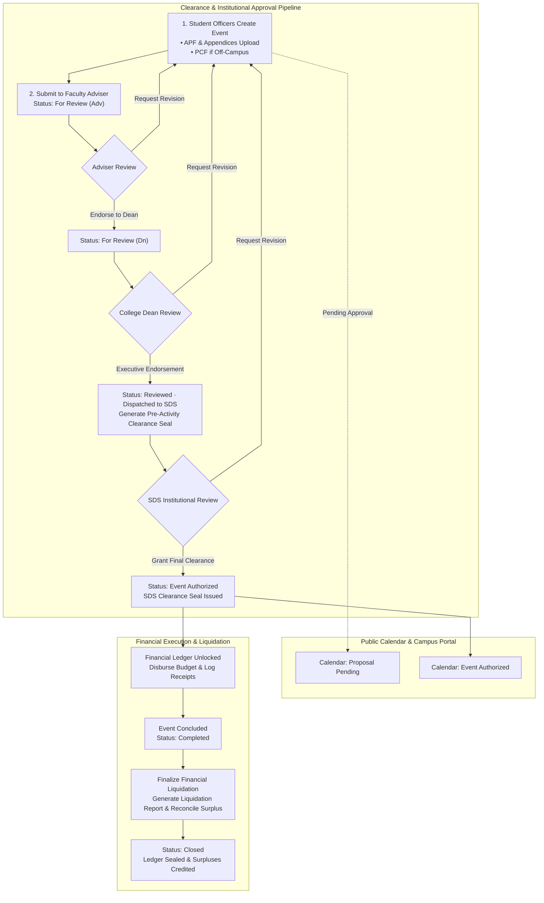

# COLLinSight

> **College Student Organization Management and Governance System with Automated Compliance Monitoring**\
> Developed for the **College of Information Technology and Engineering (CITE)** — _La Consolacion University Philippines (LCUP)_.

---

## 📌 Overview

**COLLinSight** is a centralized governance and management platform engineered to streamline student organization operations, digitize multi-level event proposal clearance workflows, monitor real-time financial ledgers with automated liquidation tracking, and maintain institutional compliance across academic departments.



---

## ✨ Key Features

### 🏛️ 4-Stage Governance & Clearance Pipeline

- **Draft & Compliance Uploads:** Student officers submit event proposals with complete program mechanics, Activity Proposal Forms (APF), and supplementary appendices.
- **Event Classifications:** Mandatory classifications for `Category` (`Organizational`, `Departmental`, `Institutional`) and `Setting` (`On-campus`, `Off-campus`).
- **Parental Consent Form (PCF) Verification:** Automated conditional requirement for off-campus events requiring signed PCF uploads before submission.
- **Dedicated Student Development Services (SDS) Portal:** SDS operates as the final campus clearance authority with a dedicated evaluation workspace, review states, and audit triggers.
- **Official Vector PDF Clearance Issuance:** Dynamic vector-drawn Activity Clearance Certificates and Financial Liquidation Reports with official university seals and signatories.
- **Bilateral Revision Cycles:** Structured revision requests with specific reviewer feedback from advisers, the dean, or SDS.

### 💰 Real-Time Financial Ledger & Liquidation

- **5-Metric Budget Summary:** High-level cards tracking Departmental Allocation, Organizational Funds, Approved Budget, Total Spent, and Remaining Balances.
- **Organizational Initiatives:** Dedicated ledger for self-generated funds (membership fees, merchandise sales, sponsorships, donations, and fundraising campaigns).
- **Automated Surplus Reinvestment:** Closing liquidated events automatically reconciles final balances and credits net event surpluses into organizational operating funds.
- **Itemized Disbursements:** Comprehensive receipt tracking with verified attachment previews, category allocation caps, and post-closure amendments.

### 🌐 Public Portal & Campus Calendars

- **Interactive Landing Page:** Modern, dark-mode-first landing page detailing platform metrics, five stakeholder roles, live status pipelines, and developer credentials.
- **Department Leadership Portals:** Dedicated organizational directories for **BSIT** (IT Student Guild), **BSCpE** (CpE Society), and **BSIE** (IE Council).
- **Public Event Calendar & Institutional Events:** Unified calendar view featuring departmental events, student activities, and administrative institutional initiatives.

### 🔐 Role-Based Portals (RBAC)

| Role                                   | Core Capabilities                                                                                                                                            |
| -------------------------------------- | ------------------------------------------------------------------------------------------------------------------------------------------------------------ |
| **Student Officers**                   | Draft event proposals, upload compliance files, record transactions, track SDS workspace submissions, and finalize liquidation.                              |
| **Faculty Advisers**                   | Review assigned organization proposals (Endorse to Dean or Return for Revision), monitor real-time ledgers, and access compliance archives.                  |
| **College Dean**                       | College-wide approval queue, executive clearance endorsement, cross-departmental financial analytics, and official clearance signing.                        |
| **Student Development Services (SDS)** | Campus-wide activity clearance review, official verification tokens, venue validation, and pre-activity clearance issuance.                                  |
| **System Administrator**               | Manage academic departments and organizations, allocate annual budget caps, configure event types & categories, manage institutional events, and audit logs. |

---

## 🔑 Pre-Configured Demo Accounts

For local demonstration and evaluation, the following pre-configured credentials are ready to use on the Login Portal:

| Role                                   | Email                        | Password            | Scope / Organization      |
| -------------------------------------- | ---------------------------- | ------------------- | ------------------------- |
| **Student Officer (President)**        | `mlopez@student.cite.edu.ph` | `lopez_124983`      | IT Student Guild (ITSG)   |
| **Faculty Adviser**                    | `ereyes@cite.edu.ph`         | `reyes_773012`      | IT Student Guild (ITSG)   |
| **College Dean**                       | `dean@cite.edu.ph`           | `villanueva_441209` | CITE (College-wide)       |
| **Student Development Services (SDS)** | `sds@cite.edu.ph`            | `collinsight_sds`   | SDS Office (Campus-wide)  |
| **System Administrator**               | `admin@cite.edu.ph`          | `cruz_882341`       | System-wide Configuration |

---

## 🚀 Quick Start

### Prerequisites

- **Node.js** (v20.x or higher recommended)
- **npm**, **pnpm**, or **yarn**

### Installation

1. **Clone the repository:**

   ```bash
   git clone https://github.com/your-username/comms-collinsight.git
   cd comms-collinsight
   ```

1. **Install dependencies:**

   ```bash
   npm install
   ```

1. **Configure Environment Variables (Optional):** Create a `.env` file in the root directory if connecting to a custom Supabase instance:

   ```env
   VITE_SUPABASE_URL=https://your-supabase-project.supabase.co
   VITE_SUPABASE_ANON_KEY=your-anon-key
   ```

   _Note: If omitted, the application runs seamlessly using the built-in managed Supabase instance or offline mock fallbacks._

1. **Start the local development server:**

   ```bash
   npm run dev
   ```

   Open `http://localhost:8443` (or the port specified in terminal output) in your browser.

1. **Build for production:**
   ```bash
   npm run build
   ```

---

## 🏗️ Project Structure

```
comms-collinsight/
├── src/
│   ├── components/
│   │   ├── events/       # Event cards, clearance modals, and timeline viewers
│   │   ├── layout/       # Navigation bars, sidebar navigation sets, and user menus
│   │   └── ui/           # Design system components (dialogs, tabs, cards, tables, badges)
│   ├── context/          # Global application state (AuthContext, AppContext)
│   ├── pages/
│   │   ├── admin/        # System configuration, institutional events, audit trail
│   │   ├── adviser/      # Proposal review queue, organization finance & reports
│   │   ├── dean/         # Executive approval queue, approved events & analytics
│   │   ├── sds/          # SDS dashboard, pending clearances, authorized events
│   │   └── student/      # Proposal builder, financial ledger, SDS workspace & reports
│   └── services/
│       ├── dataService.ts       # Domain types, formatting, and lifecycle status helpers
│       ├── mockData.ts          # Seed fixtures, test events, and fallback schemas
│       ├── pdfDocuments.ts      # Genuine vector PDF clearance & liquidation generator
│       ├── supabaseClient.ts    # Supabase connection & authentication client
│       └── supabaseService.ts   # Database CRUD mappings & storage operations
└── revision_matrix.md           # Master record of feature implementations & revisions
```

---

## 🛠️ Technology Stack

- **Framework:** [React 19](https://react.dev/) + [Vite 8](https://vite.dev/)
- **Language:** [TypeScript 5.7](https://www.typescriptlang.org/)
- **Styling:** [Tailwind CSS v4](https://tailwindcss.com/)
- **Routing:** [React Router v7](https://reactrouter.com/)
- **Backend / Database:** [Supabase](https://supabase.com/) (PostgreSQL 15, Storage Buckets, Row-Level Security)
- **Document Generation:** [jsPDF](https://github.com/parallax/jsPDF) + jsPDF-AutoTable
- **Icons:** [Lucide React](https://lucide.dev/)
- **Data Visualization:** [Recharts](https://recharts.org/)

---

## 📄 License

Developed for academic and organizational governance at the **College of Information Technology and Engineering (CITE)**, **La Consolacion University Philippines (LCUP)**.
